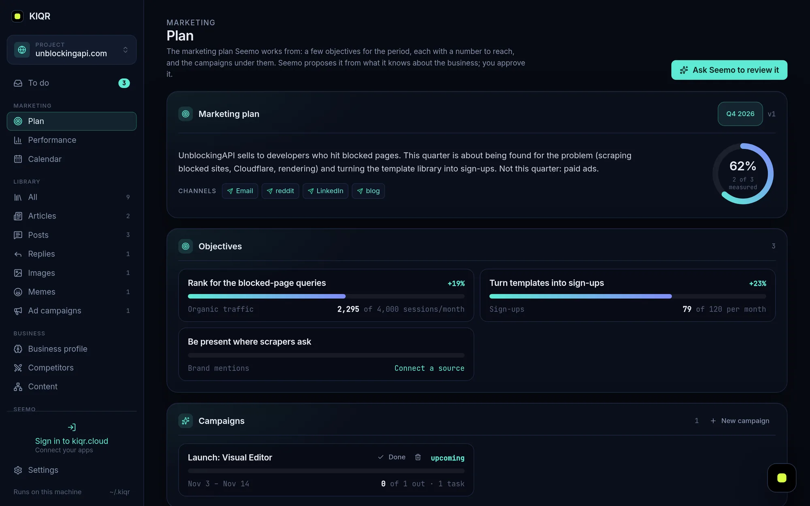
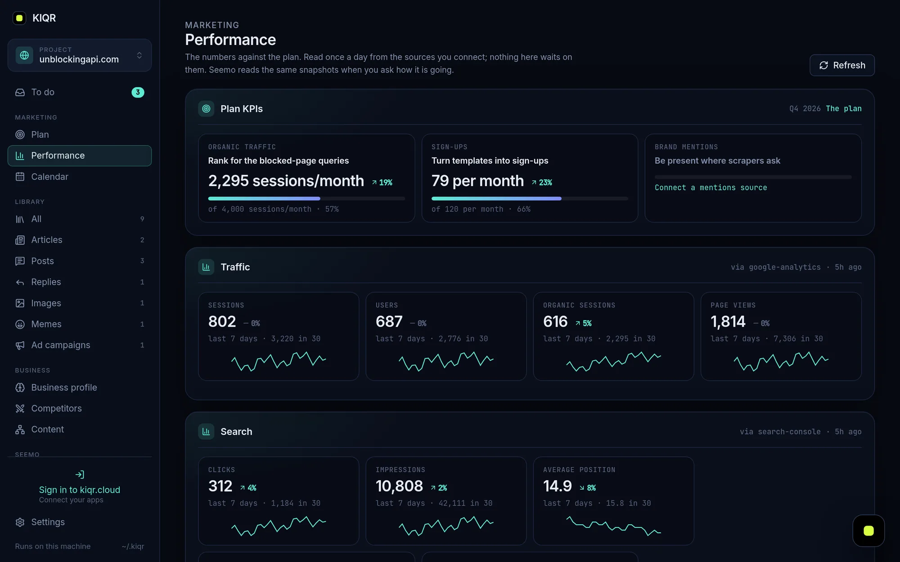
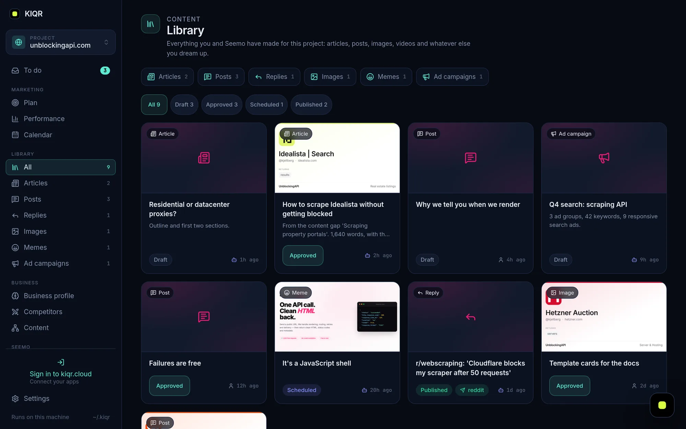

<p align="center">
  <a href="https://kiqr.dev"></a>
</p>

<p align="center">
  <a href="https://kiqr.dev"></a>
  <a href="https://kiqr.dev/docs"></a>
  <a href="https://kiqr.dev/abilities"></a>
  <a href="mailto:hello@kiqr.dev"></a>
</p>

<br>

### 👋 Meet Seemo

**Seemo is an open-source AI marketer that runs on your own computer.** Give it your website and it reads every page, proposes a marketing plan with real numbers to hit, writes the posts, articles and emails (images included), and checks your analytics every morning. It asks before anything goes out.

It thinks with the Claude or ChatGPT plan you already pay for, and keeps everything as plain files on your machine. No account, no lock-in.

```sh
curl -fsSL https://kiqr.dev/install.sh | sh     # then open http://127.0.0.1:4040
```

<table>
  <tr>
    <td width="50%"></td>
    <td width="50%"></td>
  </tr>
  <tr>
    <td width="50%"></td>
    <td width="50%"></td>
  </tr>
</table>

<br>

### 📦 What lives here

| | Repository | What it is |
| :-: | --- | --- |
|  | **[kiqr](https://github.com/kiqr/kiqr)** | KIQR itself: the daemon, the web app, the CLI, and Seemo. Rust + React, one binary. |
| 🧩 | **[marketplace](https://github.com/kiqr/marketplace)** | Abilities you can install into Seemo: Google Analytics, Search Console, Plausible, WordPress, email and more. |
| 🌐 | **[kiqr.dev](https://github.com/kiqr/kiqr.dev)** | The website, docs and marketplace pages at [kiqr.dev](https://kiqr.dev). |

<br>

### 🛠 Get involved

- **Use it** and tell us what Seemo got wrong. That's the most useful thing anyone can do right now.
- **Teach Seemo something.** An ability is a folder of Markdown and YAML. Write one and [send it to the marketplace](https://github.com/kiqr/marketplace).
- **Hack on the core.** Start with *Contribute to KIQR* in the [kiqr README](https://github.com/kiqr/kiqr#-contribute-to-kiqr).

<br>

<p align="center">
  <a href="https://kiqr.dev"></a><br>
  <sub>Open source, AGPL-3.0 · Made in Malta · <a href="https://kiqr.dev">kiqr.dev</a></sub>
</p>
